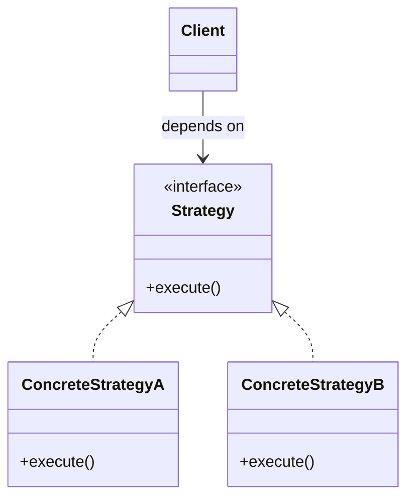

# Mermaid diagrams

Pattern lessons should include a Mermaid diagram that is rendered natively by GitHub Markdown. This is a **notation example**, not evidence that a pattern is implemented yet.

Use Mermaid class diagrams to clarify roles and sequence diagrams to clarify collaborations. Keep the diagram legible at narrow widths. Show only classes directly relevant to the lesson.
