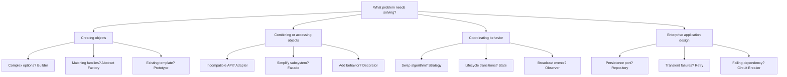

# Choose a design pattern by the problem

Start with what changes in your application. Each branch points to a runnable user guide rather than prescribing a pattern just because it exists.

Mermaid nodes are a **starting point**, not a comprehensive mapping. For the complete set of 28, see the [pattern catalog](pattern-catalog.md).

## Questions that identify the right family

### 1. Is the difficulty constructing an object?

- Too many required and optional constructor arguments: [Builder](guides/builder.md)
- Different subclasses create one kind of product: [Factory Method](guides/factory-method.md)
- Entire families of compatible objects: [Abstract Factory](guides/abstract-factory.md)
- Copy and customize an existing template: [Prototype](guides/prototype.md)
- Exactly one immutable instance per JVM: [Singleton](guides/singleton.md)

### 2. Is the difficulty putting components together?

- Incompatible legacy interface: [Adapter](guides/adapter.md)
- Two independently changing dimensions: [Bridge](guides/bridge.md)
- Tree-shaped structures: [Composite](guides/composite.md)
- Layering optional behavior: [Decorator](guides/decorator.md)
- Simplifying a subsystem entry point: [Facade](guides/facade.md)
- Sharing immutable repeated data: [Flyweight](guides/flyweight.md)
- Mediating or controlling access: [Proxy](guides/proxy.md)

### 3. Is the difficulty changing behavior or coordinating work?

- Algorithms vary at runtime: [Strategy](guides/strategy.md)
- Behavior depends on state transitions: [State](guides/state.md)
- A request may escalate through handlers: [Chain of Responsibility](guides/chain-of-responsibility.md)
- An action needs execution and undo: [Command](guides/command.md)
- A small expression grammar: [Interpreter](guides/interpreter.md)
- Traversing collections: [Iterator](guides/iterator.md)
- Many peers need orchestration: [Mediator](guides/mediator.md)
- Save and restore prior state: [Memento](guides/memento.md)
- Publish changes to subscribers: [Observer](guides/observer.md)
- Fixed algorithm with customizable steps: [Template Method](guides/template-method.md)
- New operations over stable type families: [Visitor](guides/visitor.md)

### 4. Is the problem about enterprise architecture?

- Abstract persistence: [Repository](enterprise/repository.md)
- Compose eligibility filters: [Specification](enterprise/specification.md)
- Retry selected transient failures: [Retry](enterprise/retry.md)
- Stop calls to a repeatedly failing dependency: [Circuit Breaker](enterprise/circuit-breaker.md)
- Split command handling from read projections: [CQRS](enterprise/cqrs.md)
- Wire the same plain Java abstractions with DI: [Optional Spring integration](enterprise/spring-integration.md)

## Before adding a pattern

Choose the simplest design that meets your use cases and tests. A Java record, sealed interface, lambda or conditional may be more maintainable than a formal pattern. The [comparison matrix](pattern-comparison.md) covers alternatives and hidden costs.
