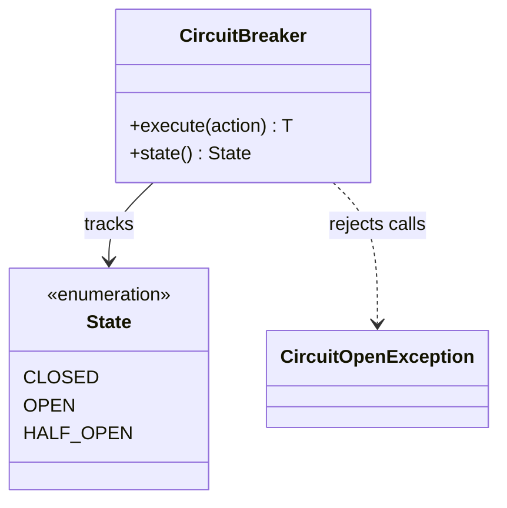

# Circuit Breaker — enterprise Java user guide

**Use it when:** Repeated calls to an unavailable dependency waste resources and amplify failures.

## Run the example

Install Java 25, then run from the repository root:

```bash
./mvnw compile
java -cp target/classes com.design.patterns.enterprise.circuitbreaker.CircuitBreakerDemo
```

Expected output:

```text
Failure recorded
Failure recorded
Circuit state: OPEN
Further call blocked
```

These examples do not call live external systems or use credentials.

## How it works

`CircuitBreaker` moves from CLOSED to OPEN after consecutive failures. OPEN rejects calls until a reset timeout; HALF_OPEN admits a trial call that closes the circuit on success or reopens it on failure. An injected `Clock` makes the tests deterministic.

## UML class diagram



## Try it yourself

Run the focused JUnit test:

```bash
./mvnw -Dtest=CircuitBreakerTest test
```

Open the Java classes in `src/main/java/com/design/patterns/enterprise/circuitbreaker/` and their tests in `src/test/java/com/design/patterns/enterprise/circuitbreaker/`. Change a value, predict the behavior and compare the assertions for valid and invalid cases.

## Real-world trade-offs

Use it when a downstream dependency frequently fails. This teaching version counts all exceptions and serializes calls; production breakers should classify failures, limit concurrent probes, emit metrics and be paired with explicit timeouts. Consider Resilience4j or Spring-native resilience libraries for real services.

Explore the [enterprise learning path](README.md), or return to the [main user guide](../USER_GUIDE.md).
