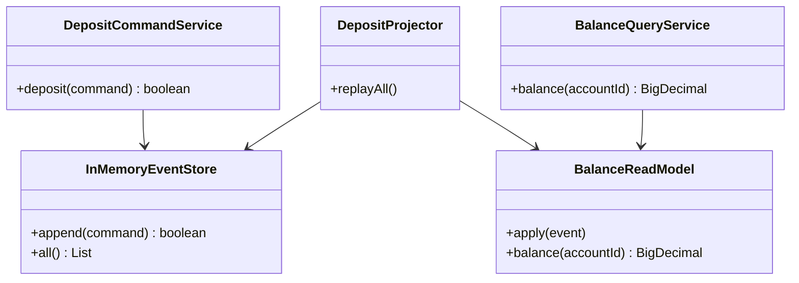

# CQRS — enterprise Java user guide

**Use it when:** Write operations and read queries have different requirements and may need different models.

## Run the example

Install Java 25, then run from the repository root:

```bash
./mvnw compile
java -cp target/classes com.design.patterns.enterprise.cqrs.CqrsDemo
```

Expected output:

```text
Before projection: 0
After projection: 25.00
```

These examples do not call live external systems or use credentials.

## How it works

`DepositCommandService` writes idempotent deposit events to an in-memory event store. `BalanceQueryService` reads a separate projection. `DepositProjector.replayAll()` explicitly updates the read model, demonstrating eventual consistency and replay safety.

## UML class diagram



## Try it yourself

Run the focused JUnit test:

```bash
./mvnw -Dtest=CqrsTest test
```

Open the Java classes in `src/main/java/com/design/patterns/enterprise/cqrs/` and their tests in `src/test/java/com/design/patterns/enterprise/cqrs/`. Change a value, predict the behavior and compare the assertions for valid and invalid cases.

## Real-world trade-offs

CQRS is useful when writes enforce business invariants and reads need independently optimized representations. This is an in-memory teaching example, NOT a durable ledger. Production payment systems need transactional event storage, concurrency controls, reliable delivery, projection checkpoints and reconciliation. Users may observe stale reads until projection occurs.

Explore the [enterprise learning path](README.md), or return to the [main user guide](../user-guide.md).
