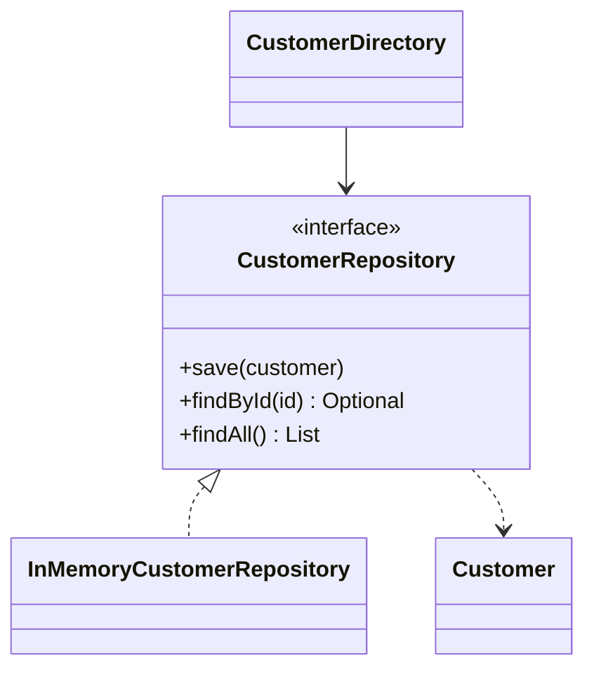

# Repository — enterprise Java user guide

**Use it when:** Business logic needs customer storage without depending on a SQL driver or an in-memory map.

## Run the example

Install Java 25, then run from the repository root:

```bash
./mvnw compile
java -cp target/classes com.design.patterns.enterprise.repository.RepositoryDemo
```

Expected output:

```text
Found customer: Alex
```

These examples do not call live external systems or use credentials.

## How it works

`CustomerRepository` defines `save`, `findById` and `findAll`. `InMemoryCustomerRepository` is an adapter. `CustomerDirectory` is a service that depends only on the port.

## UML class diagram



## Try it yourself

Run the focused JUnit test:

```bash
./mvnw -Dtest=RepositoryTest test
```

Open the Java classes in `src/main/java/com/design/patterns/enterprise/repository/` and their tests in `src/test/java/com/design/patterns/enterprise/repository/`. Change a value, predict the behavior and compare the assertions for valid and invalid cases.

## Real-world trade-offs

Use it to isolate business rules from persistence technologies. A real database adapter must handle transactions, constraints, pagination and errors. Do not introduce generic repositories just to hide useful domain operations.

Explore the [enterprise learning path](README.md), or return to the [main user guide](../USER_GUIDE.md).
