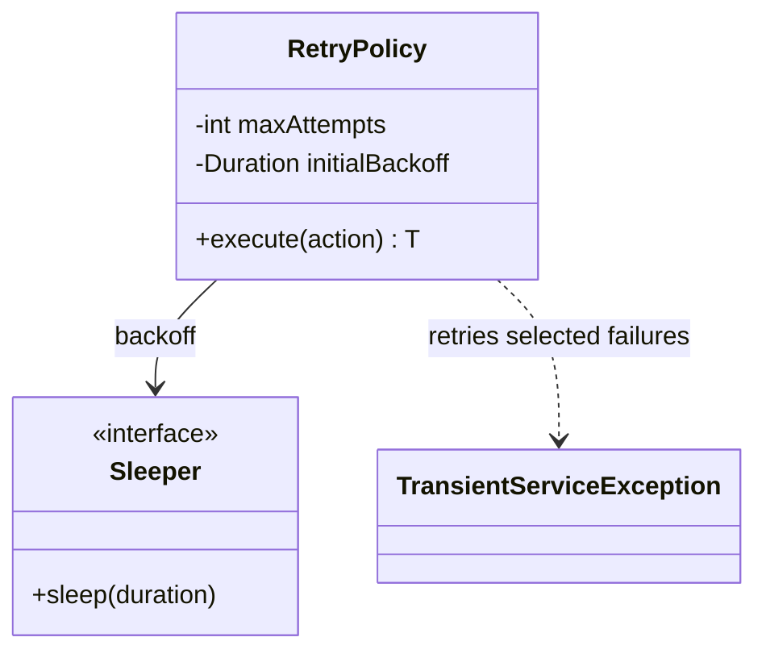

# Retry — enterprise Java user guide

**Use it when:** A transient downstream failure should not necessarily fail an operation immediately.

## Run the example

Install Java 25, then run from the repository root:

```bash
./mvnw compile
java -cp target/classes com.design.patterns.enterprise.retry.RetryDemo
```

Expected output:

```text
Payment confirmed after 3 attempts
```

These examples do not call live external systems or use credentials.

## How it works

`RetryPolicy` retries only exceptions allowed by a predicate, with bounded attempts and exponential backoff. It accepts an injected `Sleeper`, so tests and the demo run without real delays.

## UML class diagram



## Try it yourself

Run the focused JUnit test:

```bash
./mvnw -Dtest=RetryTest test
```

Open the Java classes in `src/main/java/com/design/patterns/enterprise/retry/` and their tests in `src/test/java/com/design/patterns/enterprise/retry/`. Change a value, predict the behavior and compare the assertions for valid and invalid cases.

## Real-world trade-offs

Retry only classified transient errors. For payments and commands, use idempotency keys to prevent duplicate effects. Production-grade retry should include jitter, deadlines, metrics, cancellation and overall request budgets. Don't retry validation or authorization errors.

Explore the [enterprise learning path](README.md), or return to the [main user guide](../user-guide.md).
