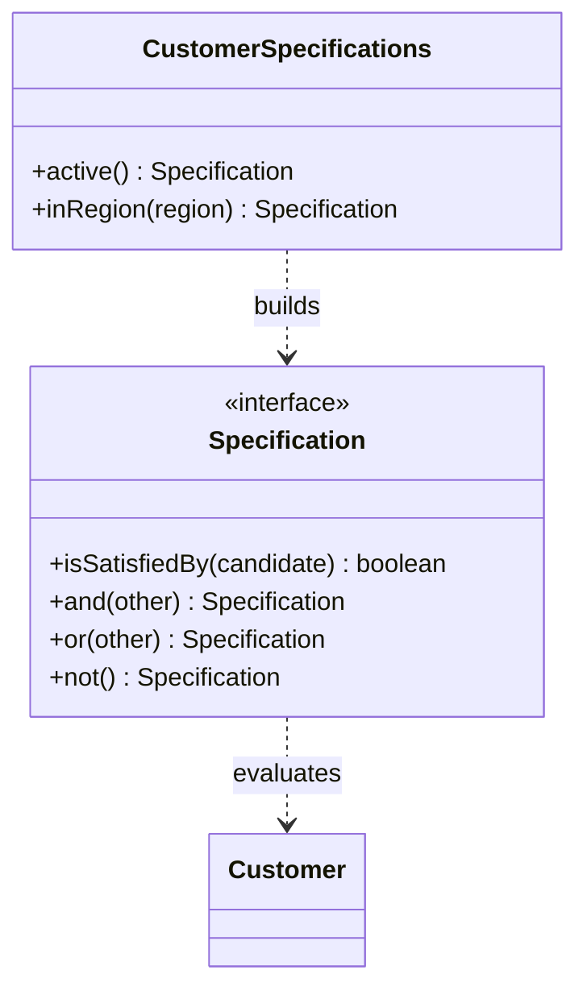

# Specification — enterprise Java user guide

**Use it when:** Eligibility rules become hard to maintain when each combination requires another conditional or query method.

## Run the example

Install Java 25, then run from the repository root:

```bash
./mvnw compile
java -cp target/classes com.design.patterns.enterprise.specification.SpecificationDemo
```

Expected output:

```text
Eligible customers: 1
```

These examples do not call live external systems or use credentials.

## How it works

`Specification<T>` exposes `isSatisfiedBy`, and provides short-circuiting `and`, `or` and `not` operations. The sample composes active customers with those in the NL region.

## UML class diagram



## Try it yourself

Run the focused JUnit test:

```bash
./mvnw -Dtest=SpecificationTest test
```

Open the Java classes in `src/main/java/com/design/patterns/enterprise/specification/` and their tests in `src/test/java/com/design/patterns/enterprise/specification/`. Change a value, predict the behavior and compare the assertions for valid and invalid cases.

## Real-world trade-offs

Excellent for reusable domain eligibility rules. This example evaluates objects in memory: it does NOT translate rules into SQL and is not the Spring Data JPA Specification API. Avoid filtering whole database tables in memory; push scalable filtering into a query adapter.

Explore the [enterprise learning path](README.md), or return to the [main user guide](../USER_GUIDE.md).
