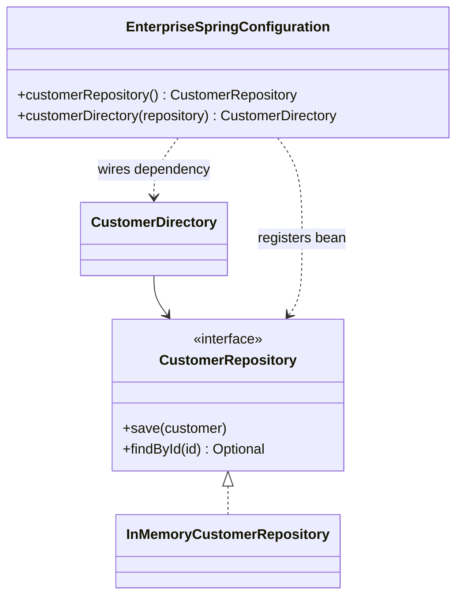

# Optional Spring Framework integration

This is an opt-in example of integrating the **plain Java Repository pattern** with Spring dependency injection. You can complete all 23 GoF and five enterprise examples without Spring.

## What this demonstrates

`EnterpriseSpringConfiguration` declares a `CustomerRepository` bean implemented by `InMemoryCustomerRepository`, then injects that port into a `CustomerDirectory` service. The domain and application classes contain **no Spring imports**.

## Run the opt-in example

JDK 25 and a working Maven connection are required for the first run. The Spring sources and dependency are activated only by the `spring-integration` Maven profile:

```bash
./mvnw -Pspring-integration clean verify
./mvnw -Pspring-integration org.codehaus.mojo:exec-maven-plugin:3.6.2:java -Dexec.mainClass=com.design.patterns.enterprise.spring.SpringIntegrationDemo
```

Expected demo output:

```text
Spring wired customer: Alex
```

To run just the Spring wiring test:

```bash
./mvnw -Pspring-integration -Dtest=SpringIntegrationTest test
```

Without the profile, `./mvnw clean verify` compiles only the framework-independent examples.

## Wiring diagram



## In a production Spring service

You can replace `InMemoryCustomerRepository` with a JDBC, JPA or cloud storage adapter without changing the `CustomerDirectory` API. Use constructor injection and define appropriate scopes and transaction boundaries. This sample uses Spring Framework Context alone: it does **not** start Spring Boot, expose a REST API, configure a database or implement production persistence.
