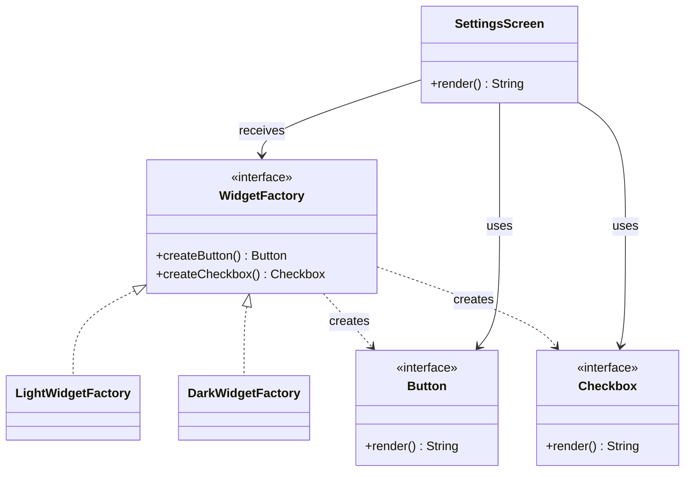

# Abstract Factory — create matching product families

**Use it when:** several components must be created together as a consistent family. In our example a Settings screen renders a button and a checkbox using either a light or dark theme.

## The problem

Constructing widgets independently can accidentally mix a light button with a dark checkbox. A `WidgetFactory` creates both related products.

## Run the example

```bash
./mvnw compile
java -cp target/classes com.design.patterns.creational.abstractfactory.AbstractFactoryDemo
```

Expected output:

```text
Light button + Light checkbox
Dark button + Dark checkbox
```

The widgets are string representations for learning purposes, not actual graphical UI controls.

## Try it in Java

```java
WidgetFactory theme = new DarkWidgetFactory();
var screen = new SettingsScreen(theme);
System.out.println(screen.render()); // Dark button + Dark checkbox
```

The client depends only on the `WidgetFactory`, `Button` and `Checkbox` interfaces. Switching the factory changes the entire family without modifying `SettingsScreen`.

## UML



The concrete factories return lightweight lambda implementations of the product interfaces. They are still separate, compatible product families.

## Verify and experiment

Run `./mvnw -Dtest=AbstractFactoryTest test`. Tests verify both families, a custom high-contrast theme and invalid factories. Create a third theme implementing `WidgetFactory`.

## Enterprise scenario and trade-offs

Factories can construct region-specific payment validator and formatter combinations, or different vendor-specific storage adapters, without mixing incompatible provider products. Avoid it when only one product varies or there is only one stable family: the extra interfaces can be unnecessary.
