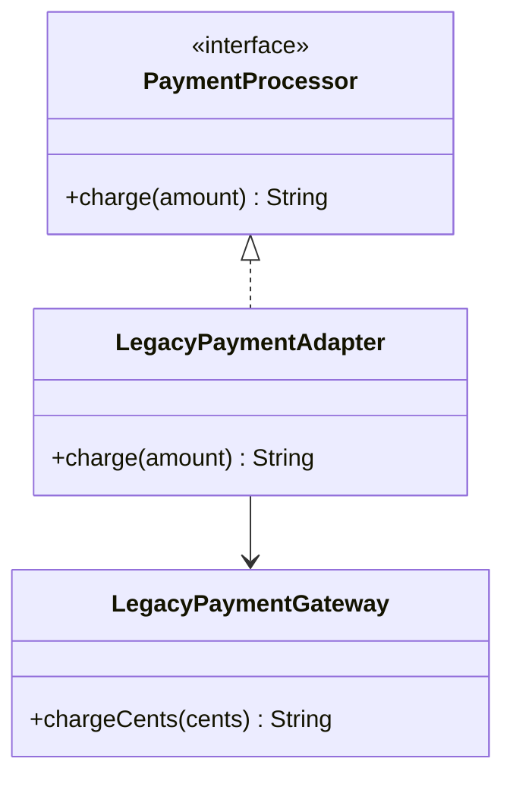

# Adapter — a practical Java 25 guide

**Problem:** A payment API accepts decimal amounts, but a legacy gateway expects integer cents.

## Get started

From the repository root, first build the classes:

```bash
./mvnw compile
java -cp target/classes com.design.patterns.structural.adapter.AdapterDemo
```

Expected output:

```text
LEGACY charged 1250 cents
```

These examples run locally and simulate the behavior. No external APIs, database or credentials are used.

## How it works

Use an Adapter when an existing API cannot be changed. The adapter converts BigDecimal amounts to exact integer cents before delegating to the legacy gateway. Fractional cents, negative amounts and overflow fail explicitly.

## Class diagram



## Try the test and explore

Run `./mvnw -Dtest=AdapterTest test`. Open `src/main/java/com/design/patterns/structural/adapter/` and its matching test package. Experiment with different inputs, predict the result and rerun the test.

## Where you'd use this

Integrate an older payment, CRM or accounting API through an adapter at the infrastructure boundary.

## When not to use it

Do not silently round monetary amounts or use Adapter when both APIs already have the same contract.

See the [user guide](../user-guide.md) to compare this pattern with the others.
