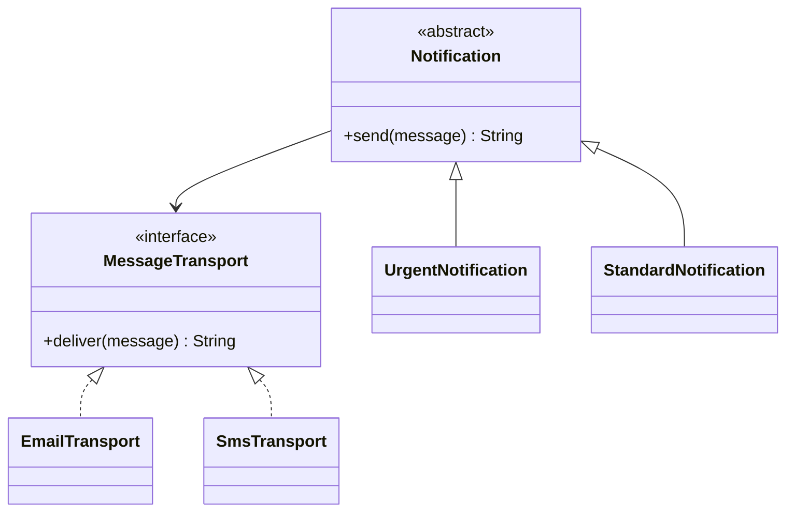

# Bridge — a practical Java 25 guide

**Problem:** Notification urgency and delivery transport change independently, causing a multiplication of subclasses.

## Get started

From the repository root, first build the classes:

```bash
./mvnw compile
java -cp target/classes com.design.patterns.structural.bridge.BridgeDemo
```

Expected output:

```text
SMS: [URGENT] Server offline
EMAIL: Daily report ready
```

These examples run locally and simulate the behavior. No external APIs, database or credentials are used.

## How it works

Separate the abstraction (Notification and urgent/standard variants) from its implementation (MessageTransport). You can combine urgency and email/SMS without a subclass for every combination.

## Class diagram



## Try the test and explore

Run `./mvnw -Dtest=BridgeTest test`. Open `src/main/java/com/design/patterns/structural/bridge/` and its matching test package. Experiment with different inputs, predict the result and rerun the test.

## Where you'd use this

Separate report formatting from export targets, or message priority from the channel that delivers it.

## When not to use it

Bridge introduces additional types; a single stable dimension can be represented more simply.

See the [user guide](../USER_GUIDE.md) to compare this pattern with the others.
