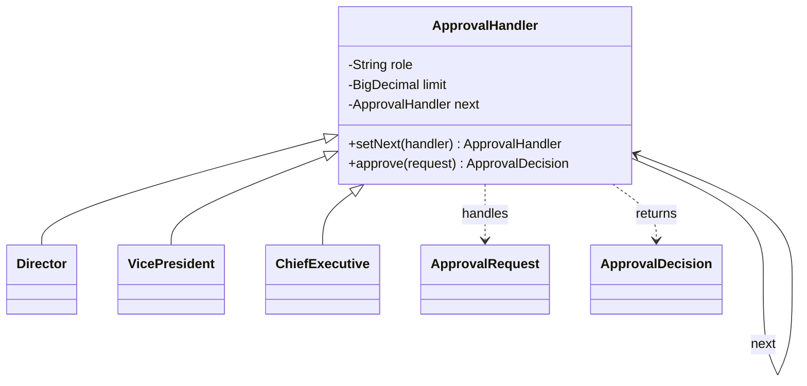

# Chain of Responsibility — route a request to an eligible handler

**Try this pattern when:** a request needs to pass through a sequence of potential handlers until one can act. Our example is a purchase approval workflow.

## The problem

A single service with hard-coded `if/else` rules for Director, Vice President and CEO must change whenever the hierarchy changes. With a chain, each handler has one responsibility: approve within its limit or pass the request to the next handler.

## Run it

```bash
./mvnw compile
java -cp target/classes com.design.patterns.behavioral.chainofresponsibility.ApprovalChainDemo
```

Expected output:

```text
PO-100.00 approved by Director
PO-900.00 approved by Vice President
PO-2000.00 approved by CEO
```

These are simulated decisions; they don't update a purchase-order system.

## Use it in your code

```java
var director = new Director();
director.setNext(new VicePresident()).setNext(new ChiefExecutive());

var decision = director.approve(
        new ApprovalRequest("PO-123", new java.math.BigDecimal("1100.00")));
System.out.println(decision.approvedBy()); // Vice President
```

The limits are inclusive: Director up to 500.00, Vice President up to 1500.00, CEO up to 100000.00. The chain throws a clear `IllegalStateException` if the request exceeds every configured approver. A negative amount or blank reference is invalid; use `BigDecimal` for money.

## How the classes collaborate



## Verify and experiment

Run `./mvnw -Dtest=ApprovalChainTest test`. The tests check all boundaries, missing eligible approvers, invalid requests and self-linking. Try a 1500.01 request and then a 100000.01 request; compare approval with the explicit failure.

## In a real application

This could be an expense-approval pipeline, API middleware or fraud review workflow. A production version would need persisted policy, an auditable decision trail, authorization and protection against cycles when handlers are configured dynamically.

**When to avoid:** a single well-defined rule may need only a conditional. Avoid creating a chain if order is ambiguous or if multiple handlers must all approve: this example intentionally stops at the first successful handler.
