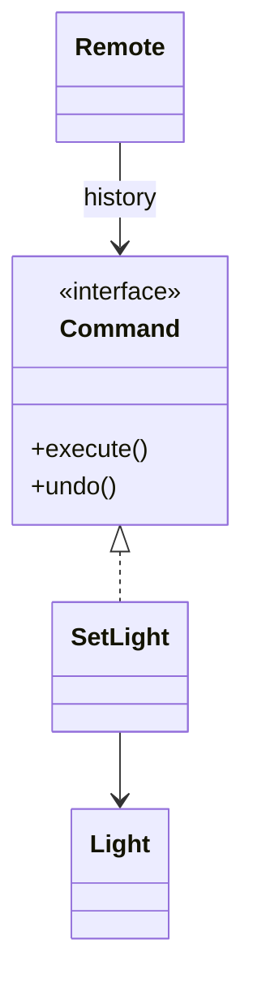

# Command — practical Java 25 lesson

**When to use it:** turn requests into objects and support undo.

## The problem

An administrator turns a light on through a remote; the command records the previous state so it can be undone.

## Run the working example

From the repository root with JDK 25:

```bash
./mvnw compile
java -cp target/classes com.design.patterns.behavioral.command.CommandDemo
```

Expected output:

```text
Light on: true
After undo: false
```

This example uses in-memory objects only and doesn't connect to external systems.

## Understand the roles

Open `src/main/java/com/design/patterns/behavioral/command/`. Start with `CommandDemo.java` and follow the collaborators in `CommandExample.java`. Notice how the pattern moves responsibilities away from a single conditional or tightly coupled class.

## UML class diagram



## Verify and experiment

```bash
./mvnw -Dtest=CommandTest test
```

Read the matching JUnit test at `src/test/java/com/design/patterns/behavioral/command/CommandTest.java`. Try changing the demo input, predict the behavior and compare the test assertions. Tests cover expected outcomes as well as invalid or boundary scenarios.

## Enterprise application and trade-offs

Command supports queued or undoable actions such as editor operations. Avoid assuming undo can reverse arbitrary external effects; design compensation and idempotency explicitly.

See the [user guide](../USER_GUIDE.md) for links to the other patterns.
