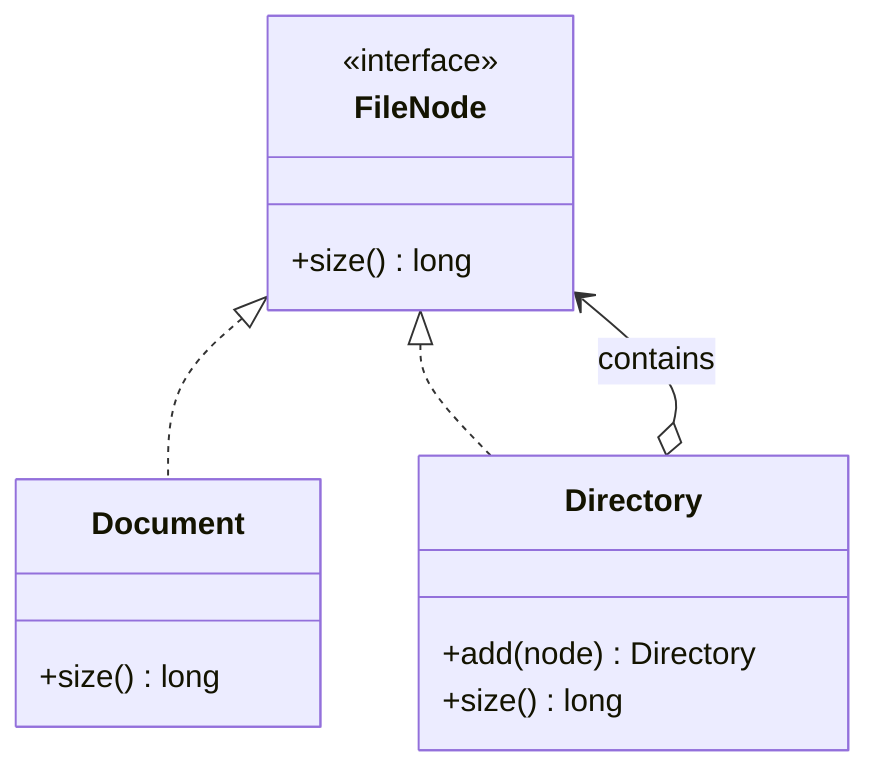

# Composite — a practical Java 25 guide

**Problem:** Files and directories need the same size-reporting operation, while directories contain other nodes.

## Get started

From the repository root, first build the classes:

```bash
./mvnw compile
java -cp target/classes com.design.patterns.structural.composite.CompositeDemo
```

Expected output:

```text
Total bytes: 1000
```

These examples run locally and simulate the behavior. No external APIs, database or credentials are used.

## How it works

Both Document (leaf) and Directory (composite) implement FileNode.size(). A Directory delegates to its children recursively and adds sizes using overflow-safe arithmetic.

## Class diagram



## Try the test and explore

Run `./mvnw -Dtest=CompositeTest test`. Open `src/main/java/com/design/patterns/structural/composite/` and its matching test package. Experiment with different inputs, predict the result and rerun the test.

## Where you'd use this

Model nested menus, organization units, product bundles or folder-like document trees.

## When not to use it

This educational example is intended for acyclic trees. Do not insert a directory into itself or create cycles; production models should enforce acyclicity.

See the [user guide](../USER_GUIDE.md) to compare this pattern with the others.
