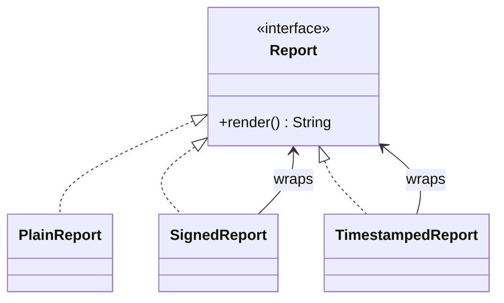

# Decorator — a practical Java 25 guide

**Problem:** Reports need optional capabilities such as timestamps and signatures without many subclasses.

## Get started

From the repository root, first build the classes:

```bash
./mvnw compile
java -cp target/classes com.design.patterns.structural.decorator.DecoratorDemo
```

Expected output:

```text
[2026-01-01] Risk summary | signed
```

These examples run locally and simulate the behavior. No external APIs, database or credentials are used.

## How it works

Wrap a PlainReport with TimestampedReport and SignedReport. Every decorator implements the same Report contract, and the client can compose them. The fixed date keeps examples deterministic.

## Class diagram



## Try the test and explore

Run `./mvnw -Dtest=DecoratorTest test`. Open `src/main/java/com/design/patterns/structural/decorator/` and its matching test package. Experiment with different inputs, predict the result and rerun the test.

## Where you'd use this

Compose validation, metrics, auditing or compression layers around a core service.

## When not to use it

Decorator order may matter. Avoid layers that obscure control flow or repeat side effects.

See the [user guide](../user-guide.md) to compare this pattern with the others.
