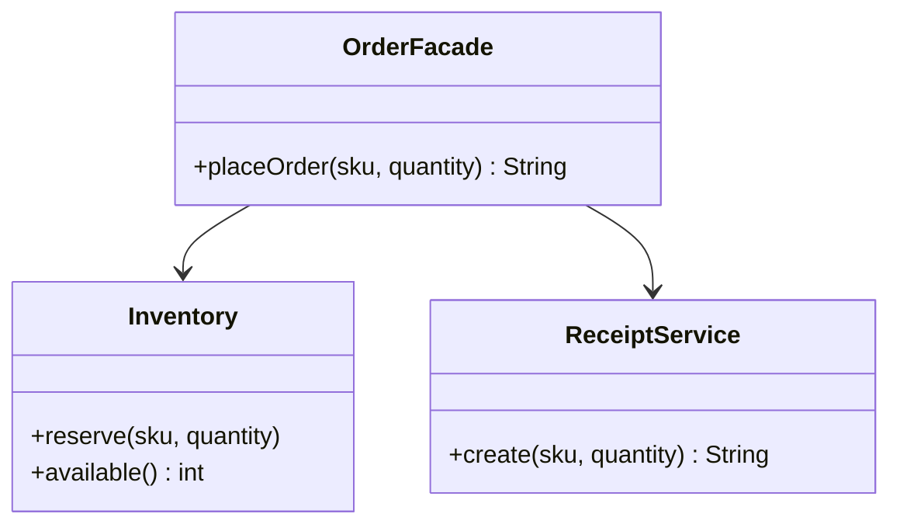

# Facade — a practical Java 25 guide

**Problem:** Order callers should not coordinate stock reservation and receipt generation themselves.

## Get started

From the repository root, first build the classes:

```bash
./mvnw compile
java -cp target/classes com.design.patterns.structural.facade.FacadeDemo
```

Expected output:

```text
Order placed: 2 x BOOK-1
```

These examples run locally and simulate the behavior. No external APIs, database or credentials are used.

## How it works

OrderFacade exposes a single placeOrder operation that checks input, reserves in-memory stock and creates a receipt, hiding the coordination from callers.

## Class diagram



## Try the test and explore

Run `./mvnw -Dtest=FacadeTest test`. Open `src/main/java/com/design/patterns/structural/facade/` and its matching test package. Experiment with different inputs, predict the result and rerun the test.

## Where you'd use this

Provide a simple API around several payment, shipping or account-management subsystems.

## When not to use it

This in-memory example is not a distributed transaction; production orders need rollback, idempotency and failure-handling rules.

See the [user guide](../user-guide.md) to compare this pattern with the others.
