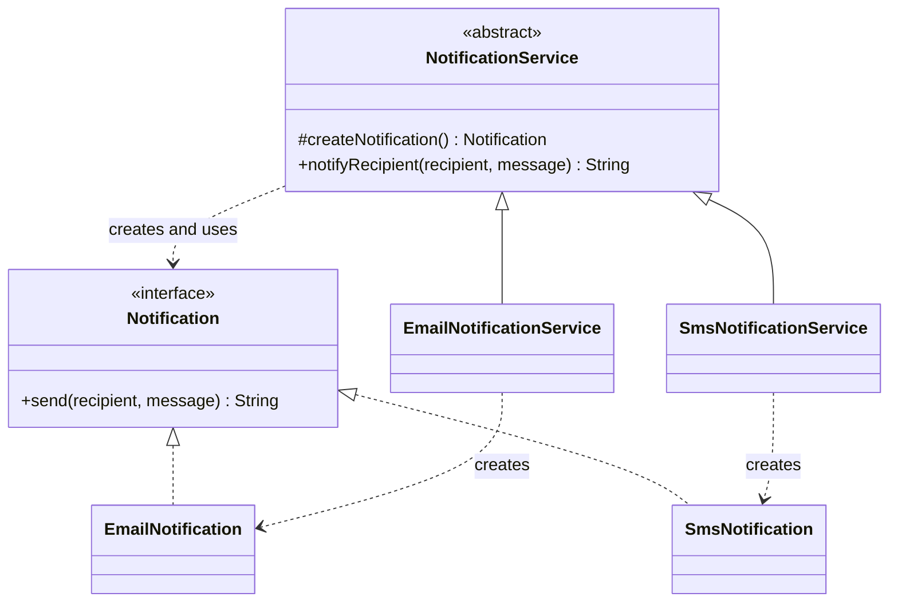

# Factory Method — let subclasses choose the product

**Use it when:** your application has a common workflow but different subclasses must decide which concrete object performs the work.

## The problem

A notification workflow should validate the recipient and message without mixing email, SMS and future delivery implementations into one large conditional.

With Factory Method, `NotificationService` implements the workflow and delegates the creation of a `Notification` to its `createNotification()` method. Subclasses select the product.

## Run the example

```bash
./mvnw compile
java -cp target/classes com.design.patterns.creational.factorymethod.FactoryMethodDemo
```

Expected output:

```text
EMAIL to alice@example.test: Invoice ready
SMS to +31000000000: Code sent
```

These are **simulated** notifications; the demo does not send real emails or texts.

## Try it in Java

```java
NotificationService service = new EmailNotificationService();
String result = service.notifyRecipient("alice@example.test", "Hello");
```

To add a push channel, implement `Notification` and a new `NotificationService` subclass. The inherited validation and send workflow stay unchanged.

## UML



## Verify and experiment

Run `./mvnw -Dtest=FactoryMethodTest test`. The tests cover both channels, extension with a new notification product and invalid input. Change the demo to use only `SmsNotificationService`.

## Enterprise scenario and trade-offs

An ingestion pipeline might select a concrete parser, while the surrounding validation and error-handling workflow stays unchanged. Factory Method is a good fit when subclasses already represent meaningful variants. If you merely need a one-line `switch` returning an implementation and no inherited workflow, a simple factory or dependency injection is often clearer.

**Factory Method vs Abstract Factory:** Factory Method creates one product through an overridable operation; Abstract Factory creates a *related family* of products.
