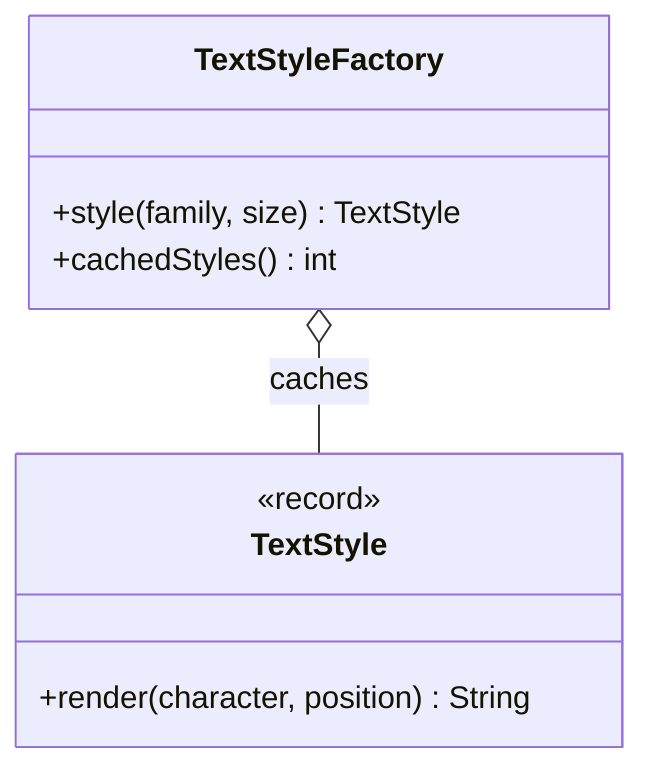

# Flyweight — a practical Java 25 guide

**Problem:** Many characters in a document share font and size but have different positions.

## Get started

From the repository root, first build the classes:

```bash
./mvnw compile
java -cp target/classes com.design.patterns.structural.flyweight.FlyweightDemo
```

Expected output:

```text
Shared style: true
A@0 [Mono/12]
Cached styles: 1
```

These examples run locally and simulate the behavior. No external APIs, database or credentials are used.

## How it works

TextStyleFactory caches immutable TextStyle values by font and size. Each character's position stays outside the flyweight. The concurrent cache avoids duplicate creations under normal concurrent lookups.

## Class diagram



## Try the test and explore

Run `./mvnw -Dtest=FlyweightTest test`. Open `src/main/java/com/design/patterns/structural/flyweight/` and its matching test package. Experiment with different inputs, predict the result and rerun the test.

## Where you'd use this

Share repeatable, immutable rendering data or repeated lookup metadata rather than duplicating it per item.

## When not to use it

A flyweight cache can grow without bound. In production, measure cardinality and add bounded eviction where appropriate.

See the [user guide](../user-guide.md) to compare this pattern with the others.
