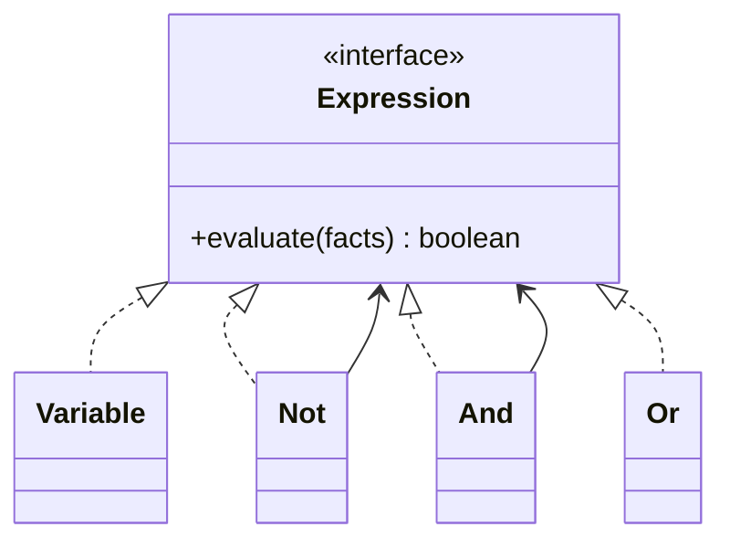

# Interpreter — practical Java 25 lesson

**When to use it:** evaluate a small domain language.

## The problem

An access rule is composed from Variable, NOT, AND and OR expressions, then evaluated against a set of facts.

## Run the working example

From the repository root with JDK 25:

```bash
./mvnw compile
java -cp target/classes com.design.patterns.behavioral.interpreter.InterpreterDemo
```

Expected output:

```text
Access allowed: true
```

This example uses in-memory objects only and doesn't connect to external systems.

## Understand the roles

Open `src/main/java/com/design/patterns/behavioral/interpreter/`. Start with `InterpreterDemo.java` and follow the collaborators in `InterpreterExample.java`. Notice how the pattern moves responsibilities away from a single conditional or tightly coupled class.

## UML class diagram



## Verify and experiment

```bash
./mvnw -Dtest=InterpreterTest test
```

Read the matching JUnit test at `src/test/java/com/design/patterns/behavioral/interpreter/InterpreterTest.java`. Try changing the demo input, predict the behavior and compare the test assertions. Tests cover expected outcomes as well as invalid or boundary scenarios.

## Enterprise application and trade-offs

Useful for small, constrained eligibility rules. This demo builds the expression tree in Java and does not parse untrusted text. For larger grammars, use a parser generator or dedicated rules engine.

See the [user guide](../USER_GUIDE.md) for links to the other patterns.
