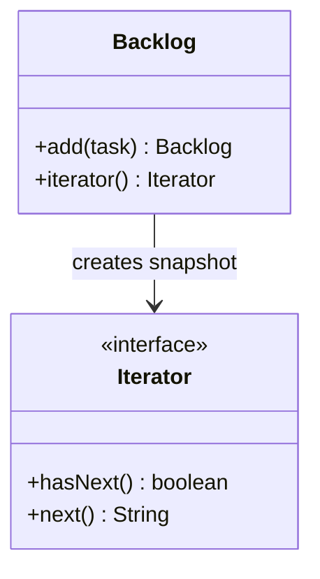

# Iterator — practical Java 25 lesson

**When to use it:** traverse elements without exposing collection internals.

## The problem

A backlog exposes Iterable so a caller can loop over tasks without depending on its backing list.

## Run the working example

From the repository root with JDK 25:

```bash
./mvnw compile
java -cp target/classes com.design.patterns.behavioral.iterator.IteratorDemo
```

Expected output:

```text
Task: Design
Task: Review
```

This example uses in-memory objects only and doesn't connect to external systems.

## Understand the roles

Open `src/main/java/com/design/patterns/behavioral/iterator/`. Start with `IteratorDemo.java` and follow the collaborators in `IteratorExample.java`. Notice how the pattern moves responsibilities away from a single conditional or tightly coupled class.

## UML class diagram



## Verify and experiment

```bash
./mvnw -Dtest=IteratorTest test
```

Read the matching JUnit test at `src/test/java/com/design/patterns/behavioral/iterator/IteratorTest.java`. Try changing the demo input, predict the behavior and compare the test assertions. Tests cover expected outcomes as well as invalid or boundary scenarios.

## Enterprise application and trade-offs

Java already supplies Iterable and Iterator; use them rather than inventing new cursor APIs. The demo's iterator is a read-only snapshot, not a live view.

See the [user guide](../USER_GUIDE.md) for links to the other patterns.
