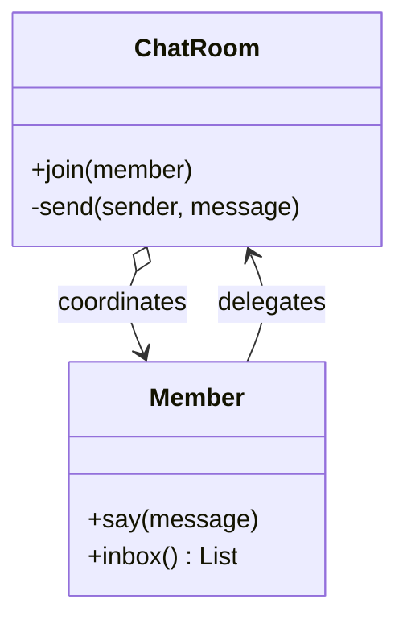

# Mediator — practical Java 25 lesson

**When to use it:** coordinate collaborating objects through one hub.

## The problem

A chat room forwards Alice's message to Bob without participants storing references to each other.

## Run the working example

From the repository root with JDK 25:

```bash
./mvnw compile
java -cp target/classes com.design.patterns.behavioral.mediator.MediatorDemo
```

Expected output:

```text
Bob received: Alice: Build ready
```

This example uses in-memory objects only and doesn't connect to external systems.

## Understand the roles

Open `src/main/java/com/design/patterns/behavioral/mediator/`. Start with `MediatorDemo.java` and follow the collaborators in `MediatorExample.java`. Notice how the pattern moves responsibilities away from a single conditional or tightly coupled class.

## UML class diagram



## Verify and experiment

```bash
./mvnw -Dtest=MediatorTest test
```

Read the matching JUnit test at `src/test/java/com/design/patterns/behavioral/mediator/MediatorTest.java`. Try changing the demo input, predict the behavior and compare the test assertions. Tests cover expected outcomes as well as invalid or boundary scenarios.

## Enterprise application and trade-offs

Useful for chat rooms, workflows and complex UI coordination. Beware of turning the mediator into an unmaintainable god object.

See the [user guide](../USER_GUIDE.md) for links to the other patterns.
