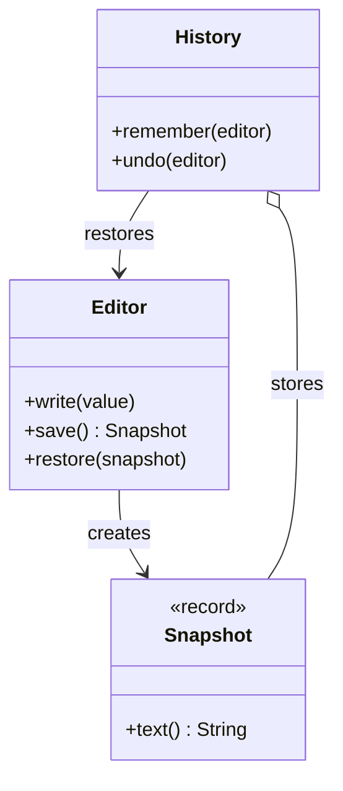

# Memento — practical Java 25 lesson

**When to use it:** restore earlier state without exposing mutable internals.

## The problem

An editor saves a text snapshot, edits the document, then restores the previous version.

## Run the working example

From the repository root with JDK 25:

```bash
./mvnw compile
java -cp target/classes com.design.patterns.behavioral.memento.MementoDemo
```

Expected output:

```text
Restored: Version one
```

This example uses in-memory objects only and doesn't connect to external systems.

## Understand the roles

Open `src/main/java/com/design/patterns/behavioral/memento/`. Start with `MementoDemo.java` and follow the collaborators in `MementoExample.java`. Notice how the pattern moves responsibilities away from a single conditional or tightly coupled class.

## UML class diagram



## Verify and experiment

```bash
./mvnw -Dtest=MementoTest test
```

Read the matching JUnit test at `src/test/java/com/design/patterns/behavioral/memento/MementoTest.java`. Try changing the demo input, predict the behavior and compare the test assertions. Tests cover expected outcomes as well as invalid or boundary scenarios.

## Enterprise application and trade-offs

Use snapshots for editor undo, configuration revisions and in-memory checkpoints. Large snapshots consume memory, and snapshots are not a substitute for durable persistence.

See the [user guide](../user-guide.md) for links to the other patterns.
