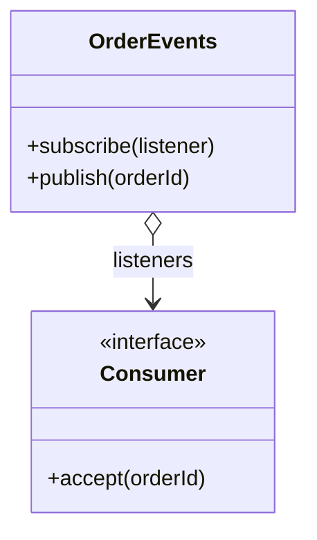

# Observer — practical Java 25 lesson

**When to use it:** notify subscribers when an event happens.

## The problem

One order event fans out to independent email and audit observers.

## Run the working example

From the repository root with JDK 25:

```bash
./mvnw compile
java -cp target/classes com.design.patterns.behavioral.observer.ObserverDemo
```

Expected output:

```text
Email notified: ORDER-42
Audit recorded: ORDER-42
```

This example uses in-memory objects only and doesn't connect to external systems.

## Understand the roles

Open `src/main/java/com/design/patterns/behavioral/observer/`. Start with `ObserverDemo.java` and follow the collaborators in `ObserverExample.java`. Notice how the pattern moves responsibilities away from a single conditional or tightly coupled class.

## UML class diagram



## Verify and experiment

```bash
./mvnw -Dtest=ObserverTest test
```

Read the matching JUnit test at `src/test/java/com/design/patterns/behavioral/observer/ObserverTest.java`. Try changing the demo input, predict the behavior and compare the test assertions. Tests cover expected outcomes as well as invalid or boundary scenarios.

## Enterprise application and trade-offs

Use in-process publish/subscribe for decoupled updates. These callbacks execute synchronously and a listener exception can interrupt delivery; production messaging needs explicit error and delivery policies.

See the [user guide](../USER_GUIDE.md) for links to the other patterns.
