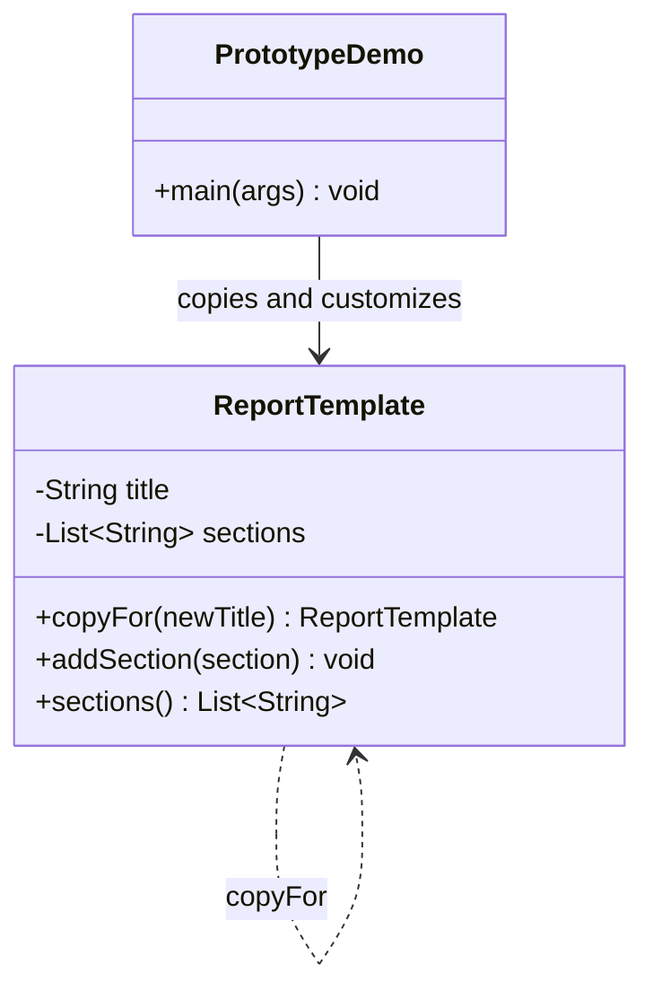

# Prototype — copy a configured starting point

**Use it when:** you repeatedly create objects that start from an existing configuration but must later vary independently.

## The problem

A report template already contains default sections. Rebuilding each similar report manually duplicates configuration and makes future changes awkward.

With Prototype, copy the configured template and customize the result without changing the original. This example uses an explicit `copyFor` method rather than `Object.clone()`.

## Run the example

```bash
./mvnw compile
java -cp target/classes com.design.patterns.creational.prototype.PrototypeDemo
```

Expected output:

```text
ReportTemplate[title=Standard, sections=[Summary, Risks]]
ReportTemplate[title=Quarterly, sections=[Summary, Risks, Forecast]]
```

## Try it in Java

```java
var baseline = new ReportTemplate("Standard", java.util.List.of("Summary", "Risks"));
var monthly = baseline.copyFor("Monthly");
monthly.addSection("Revenue");
System.out.println(baseline.sections()); // [Summary, Risks]
System.out.println(monthly.sections());  // [Summary, Risks, Revenue]
```

`ReportTemplate` makes a defensive copy of the input list. Each new prototype copy gets its own list; its `sections()` accessor exposes an immutable snapshot. Copying must be *deep enough* for the fields being modeled. Here, Strings are immutable, so copying the list is sufficient.

## UML



## Verify and experiment

Run `./mvnw -Dtest=PrototypeTest test`. The tests cover independent copies, defensive copying, read-only snapshots and invalid input. Try adding a different section to two copies of the same original.

## Enterprise scenario and trade-offs

Duplicate a configured test case or report definition before tailoring it for a new tenant or run. Take particular care with nested mutable objects: a shallow copy might leak changes across copies. A constructor or factory is simpler when no existing configured object needs to be reused.
