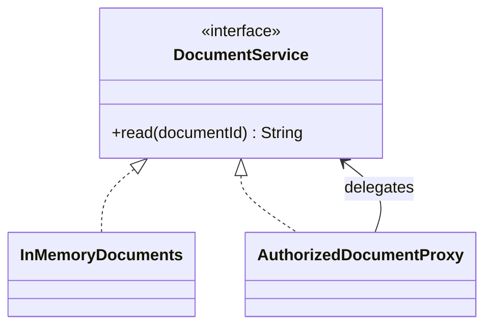

# Proxy — a practical Java 25 guide

**Problem:** Reading sensitive documents should be guarded before the underlying document service is invoked.

## Get started

From the repository root, first build the classes:

```bash
./mvnw compile
java -cp target/classes com.design.patterns.structural.proxy.ProxyDemo
```

Expected output:

```text
Internal policy
```

These examples run locally and simulate the behavior. No external APIs, database or credentials are used.

## How it works

AuthorizedDocumentProxy implements the same DocumentService interface as InMemoryDocuments. It rejects unauthorized requests before delegating to the target.

## Class diagram



## Try the test and explore

Run `./mvnw -Dtest=ProxyTest test`. Open `src/main/java/com/design/patterns/structural/proxy/` and its matching test package. Experiment with different inputs, predict the result and rerun the test.

## Where you'd use this

Add authorization checks, caching, lazy loading or request tracing to an existing service interface.

## When not to use it

The boolean permission flag is for demonstration only. Real systems must authorize every request against authenticated identity and document-level access policies.

See the [user guide](../user-guide.md) to compare this pattern with the others.
