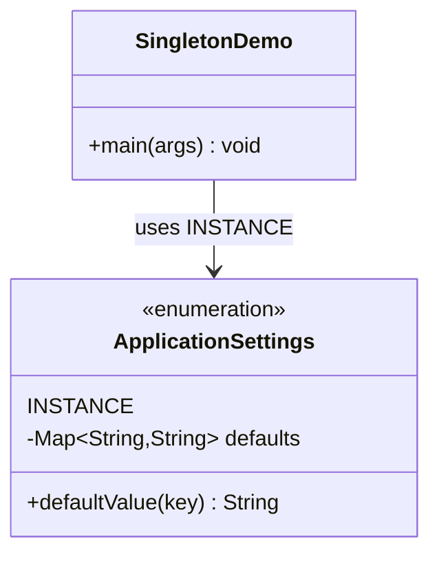

# Singleton — one shared instance

**Use it when:** an object must have exactly one instance in a JVM, such as a fixed, immutable default-settings snapshot.

## The problem

If each part of an application constructs a separate global-settings object, you can accidentally maintain multiple conflicting copies. A Singleton makes one instance accessible to all callers.

## Run the example

From the project root, after installing JDK 25:

```bash
./mvnw compile
java -cp target/classes com.design.patterns.creational.singleton.SingletonDemo
```

Expected output:

```text
Same instance: true
Default currency: EUR
```

## Try it in Java

```java
var settings = ApplicationSettings.INSTANCE;
System.out.println(settings.defaultValue("region")); // eu-west
```

This example uses an **enum Singleton**, which has built-in JVM initialization guarantees and avoids many serialization and reflection pitfalls common to manual Singleton implementations. Its settings are immutable after initialization.

## UML



## Check your understanding

Run `./mvnw -Dtest=SingletonTest test`. The tests assert identity across callers and threads and verify invalid keys are rejected. Modify the demo to print `defaultValue("region")`.

## Enterprise scenario and trade-offs

A JVM-wide table of immutable default feature flags is a simple candidate. **Do not** use a Singleton for tenant-specific mutable configuration, user sessions or state that must be isolated in tests. In Spring applications, dependency injection with a single scoped bean is often simpler and more testable. One JVM instance does not mean one instance across distributed services.
