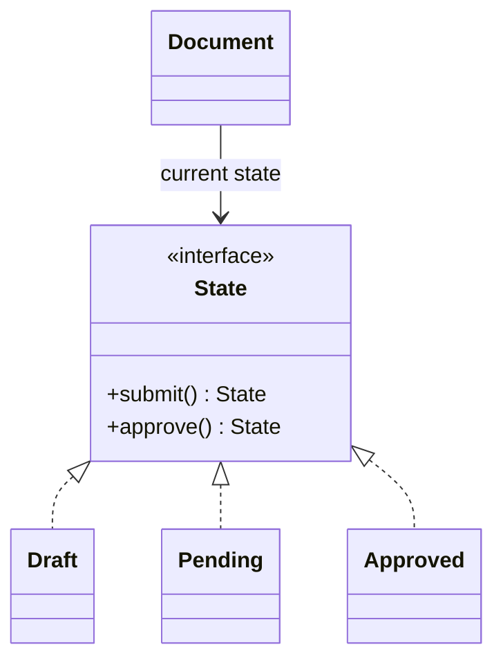

# State — practical Java 25 lesson

**When to use it:** represent legal behavior based on lifecycle state.

## The problem

A document progresses from Draft through Pending to Approved; invalid transitions fail.

## Run the working example

From the repository root with JDK 25:

```bash
./mvnw compile
java -cp target/classes com.design.patterns.behavioral.state.StateDemo
```

Expected output:

```text
After submit: Pending
After approve: Approved
```

This example uses in-memory objects only and doesn't connect to external systems.

## Understand the roles

Open `src/main/java/com/design/patterns/behavioral/state/`. Start with `StateDemo.java` and follow the collaborators in `StateExample.java`. Notice how the pattern moves responsibilities away from a single conditional or tightly coupled class.

## UML class diagram



## Verify and experiment

```bash
./mvnw -Dtest=StateTest test
```

Read the matching JUnit test at `src/test/java/com/design/patterns/behavioral/state/StateTest.java`. Try changing the demo input, predict the behavior and compare the test assertions. Tests cover expected outcomes as well as invalid or boundary scenarios.

## Enterprise application and trade-offs

Useful for approval, order and payment lifecycles when permitted actions vary by state. For a handful of stable states, an enum and explicit transitions can be simpler.

See the [user guide](../user-guide.md) for links to the other patterns.
