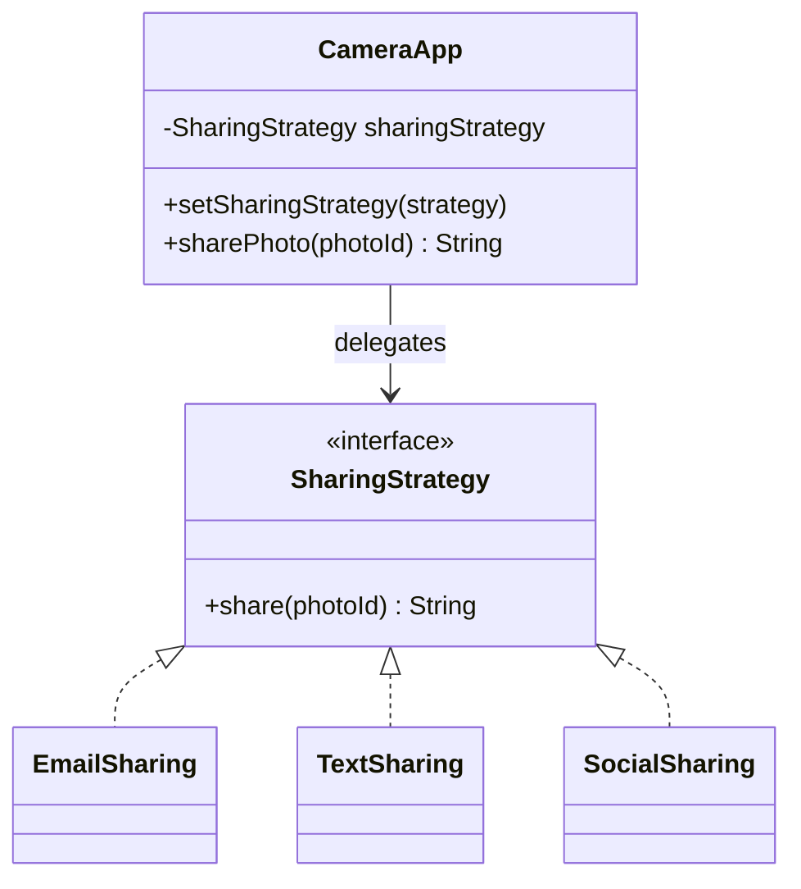

# Strategy — change an algorithm without changing its caller

**Try this pattern when:** your application supports several ways to accomplish one task. In this example, a camera can share photos via email, SMS-style text or social media.

## The problem

Without Strategy, a camera might have a long `switch` choosing the sharing channel. Every new channel would require editing the camera class and retesting unrelated behavior.

**What changes:** the camera depends on a `SharingStrategy` interface. Each channel implements the same contract and can be selected at runtime.

## Run it

From the repository root:

```bash
./mvnw compile
java -cp target/classes com.design.patterns.behavioral.strategy.StrategyDemo
```

Expected output:

```text
Email sent for photo holiday-001
Social post created for photo holiday-001
```

The messages simulate sharing for learning purposes. **No email, text or social post is actually sent.**

## Use it in your code

```java
var camera = new CameraApp(new EmailSharing());
System.out.println(camera.sharePhoto("trip-42"));
camera.setSharingStrategy(new TextSharing());
System.out.println(camera.sharePhoto("trip-42"));
```

You can also supply a lambda since `SharingStrategy` is a functional interface:

```java
camera.setSharingStrategy(photoId -> "Queued " + photoId);
```

All strategies return a string instead of writing directly to the console, so they can be tested. The camera rejects null strategies and blank photo identifiers.

## How the classes collaborate



## Verify and experiment

Run `./mvnw -Dtest=StrategyTest test`. The test checks all three implementations, a lambda, runtime switching and rejection of invalid input. Try changing the demo to use `new TextSharing()` first, then observe how the output changes.

## In a real application

A checkout service can select a payment-routing strategy by provider or region; the checkout code doesn't need to know a provider's internal details. Each strategy would call an injected provider client and handle provider-specific failures.

**When to avoid:** if there are only two stable branches and no expectation of variation, a simple conditional may be easier to maintain. Strategy adds interfaces and classes, not free flexibility.
