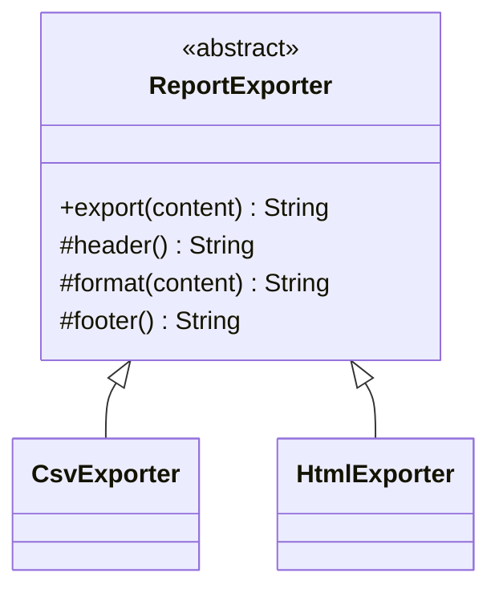

# Template Method — practical Java 25 lesson

**When to use it:** keep an algorithm fixed while varying specific steps.

## The problem

An exporter enforces one flow—validate, header, format, footer—while CSV and HTML exporters customize formatting.

## Run the working example

From the repository root with JDK 25:

```bash
./mvnw compile
java -cp target/classes com.design.patterns.behavioral.templatemethod.TemplateMethodDemo
```

Expected output:

```text
<html><p>Revenue &lt; 100</p></html>
```

This example uses in-memory objects only and doesn't connect to external systems.

## Understand the roles

Open `src/main/java/com/design/patterns/behavioral/templatemethod/`. Start with `TemplateMethodDemo.java` and follow the collaborators in `TemplateMethodExample.java`. Notice how the pattern moves responsibilities away from a single conditional or tightly coupled class.

## UML class diagram



## Verify and experiment

```bash
./mvnw -Dtest=TemplateMethodTest test
```

Read the matching JUnit test at `src/test/java/com/design/patterns/behavioral/templatemethod/TemplateMethodTest.java`. Try changing the demo input, predict the behavior and compare the test assertions. Tests cover expected outcomes as well as invalid or boundary scenarios.

## Enterprise application and trade-offs

Use when several workflows follow one stable algorithm. Overridden hooks create inheritance coupling; prefer composition if the variation is highly dynamic.

See the [user guide](../user-guide.md) for links to the other patterns.
