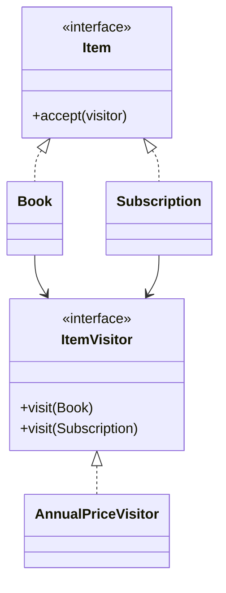

# Visitor — practical Java 25 lesson

**When to use it:** add operations to a stable hierarchy without modifying its types.

## The problem

A visitor computes annual prices for one-time book purchases and monthly subscriptions.

## Run the working example

From the repository root with JDK 25:

```bash
./mvnw compile
java -cp target/classes com.design.patterns.behavioral.visitor.VisitorDemo
```

Expected output:

```text
Annual total: 150.00
```

This example uses in-memory objects only and doesn't connect to external systems.

## Understand the roles

Open `src/main/java/com/design/patterns/behavioral/visitor/`. Start with `VisitorDemo.java` and follow the collaborators in `VisitorExample.java`. Notice how the pattern moves responsibilities away from a single conditional or tightly coupled class.

## UML class diagram



## Verify and experiment

```bash
./mvnw -Dtest=VisitorTest test
```

Read the matching JUnit test at `src/test/java/com/design/patterns/behavioral/visitor/VisitorTest.java`. Try changing the demo input, predict the behavior and compare the test assertions. Tests cover expected outcomes as well as invalid or boundary scenarios.

## Enterprise application and trade-offs

Useful when your element hierarchy is stable but you add multiple operations. Adding new item types requires updating visitors; sealed types and pattern matching may be simpler for small models.

See the [user guide](../USER_GUIDE.md) for links to the other patterns.
